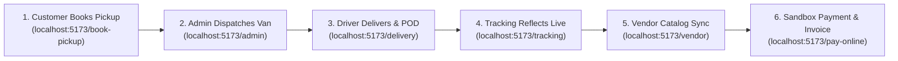

# Client Demonstration Access Guide & Operator Runbook
**Project:** Sai International Couriers & Cargo  
**Platform Architecture:** React 18 (Vite) + Node.js (Express) + MongoDB Atlas + Capacitor Android  
**Target Environment:** Local Windows Demonstration (`http://localhost:5173` & `http://localhost:5000`)  
**Audit & Verification Date:** November 2026  
**Status:** READY FOR LIVE CLIENT DEMONSTRATION  

---

## 1. System Access Points & Service URLs

| Interface / Portal | Local Access URL | Port / Protocol | Target User / Role |
| :--- | :--- | :--- | :--- |
| **Public Customer Website** | [http://localhost:5173](http://localhost:5173) | Frontend (Vite) | General Public, NRI Senders, Guests |
| **Backend API Health Check** | [http://localhost:5000/api/health](http://localhost:5000/api/health) | Backend (Express) | DevOps, System Health Probes |
| **Cost & Quota Audit API** | [http://localhost:5000/api/v1/cost-audit](http://localhost:5000/api/v1/cost-audit) | Backend (Express) | Admin Cost & Quota Oversight ($0.00 Spend) |
| **Customer Portal (Login)** | [http://localhost:5173/login](http://localhost:5173/login) | Frontend (React) | Registered NRI Customers & Consignors |
| **Customer Dashboard** | [http://localhost:5173/dashboard](http://localhost:5173/dashboard) | Frontend (React) | Authenticated Customers |
| **Super Admin Command Center** | [http://localhost:5173/admin/login](http://localhost:5173/admin/login) | Frontend (React) | Operations Managers, Super Administrators |
| **B2B Vendor Portal** | [http://localhost:5173/vendor/login](http://localhost:5173/vendor/login) | Frontend (React) | Sweet Shops, Bakeries, Pickles Exporters |
| **Delivery Agent Mobile Web App** | [http://localhost:5173/delivery/login](http://localhost:5173/delivery/login) | Frontend (Capacitor) | Van Drivers, Delivery Executives |
| **Online Bill Payment Portal** | [http://localhost:5173/pay-online](http://localhost:5173/pay-online) | Frontend (React) | Senders & Consignees (Sandbox Mode) |
| **Public Live Tracking Radar** | [http://localhost:5173/tracking](http://localhost:5173/tracking) | Frontend (React) | Any User with an AWB |
| **NRI Food Shipping Page** | [http://localhost:5173/food-shipping](http://localhost:5173/food-shipping) | Frontend (React) | Homemade Pickles & Vacuum Packaging Info |
| **Rate Calculator** | [http://localhost:5173/calculator](http://localhost:5173/calculator) | Frontend (React) | International Volumetric Rate Quoting |
| **24/7 Logistics Helpdesk** | [http://localhost:5173/help-center](http://localhost:5173/help-center) | Frontend (React) | Customer Support Ticketing System |

---

## 2. Dedicated Role-Based Demo Credentials

Following enterprise security standards, all demo passwords have been rotated and are stored strictly in a local-only file:
`c:\Users\shaik\Desktop\Sai international\DEMO_CREDENTIALS_LOCAL_ONLY.txt`
This file is air-gapped and excluded from Git (`.gitignore`) to prevent any secret exposure.

| Portal Role | Login Email / Identifier | Password Reference | Access Level & Scope |
| :--- | :--- | :--- | :--- |
| **Super Administrator** | `sai.world.cc@gmail.com` | `[Stored in DEMO_CREDENTIALS_LOCAL_ONLY.txt]` | Full system control: Fleet dispatch, rates, master ledger, staff, settings. |
| **Registered Customer** | `demo.customer@saicouriers.com` | `[Stored in DEMO_CREDENTIALS_LOCAL_ONLY.txt]` | View active bookings, download consignment PDFs, submit RFQs. |
| **B2B Vendor (Store Owner)**| `Vendor1@gmail.com` | `[Stored in DEMO_CREDENTIALS_LOCAL_ONLY.txt]` | Store: *Sri Sai Sweets & Bakery*. Product catalog, order queue, escrow balance. |
| **Delivery Executive** | `driver@sai.com` | `[Stored in DEMO_CREDENTIALS_LOCAL_ONLY.txt]` | Name: *Test Delivery Driver*. Route optimization, task status, POD camera/upload. |
| **Public / Guest** | *No authentication required* | *None* | Rate calculator, public tracking, doorstep pickup request form. |

---

## 3. End-to-End Client Demonstration Workflow

Follow this 6-step walkthrough to demonstrate the full logistics lifecycle to your client:

### Step 1: Customer Booking & Instant AWB Generation
1. Open [http://localhost:5173/book-pickup](http://localhost:5173/book-pickup) or [http://localhost:5173/contact](http://localhost:5173/contact).
2. Enter sender name (e.g., `Rajesh Kumar`), mobile (`9059949365`), and Kadapa pickup address.
3. Select Destination Country: **USA**, Shipment Category: **NRI Homemade Food & Pickles**, Weight: **5 kg to 10 kg**.
4. Solve the Math CAPTCHA and submit.
5. **Demonstration Point:** The screen displays an instant booking confirmation with an auto-generated Air Waybill (e.g., `SAI-15267-USA`) and dispatches a real-time notification to the admin console.

### Step 2: Super Admin Dispatch & Driver Assignment
1. Open [http://localhost:5173/admin/login](http://localhost:5173/admin/login) in a new tab.
2. Sign in as `sai.world.cc@gmail.com` using the password from `DEMO_CREDENTIALS_LOCAL_ONLY.txt`.
3. Navigate to **Bookings** to see the new booking at the top of the list.
4. Navigate to **Shipments** -> Click **Create Master Shipment Record**.
5. Assign the shipment to **Test Delivery Driver** (`driver@sai.com`).
6. **Demonstration Point:** Master dispatch manifests are created instantly with multi-carrier partner selection (DHL, FedEx, UPS, or Sai Self Network).

### Step 3: Delivery Executive Mobile Task & Proof of Delivery
1. Open [http://localhost:5173/delivery/login](http://localhost:5173/delivery/login) (or view on phone on the same Wi-Fi at `http://<YOUR_IP>:5173/delivery/login`).
2. Sign in as `driver@sai.com` using the password from `DEMO_CREDENTIALS_LOCAL_ONLY.txt`.
3. View the task list showing the assigned consignment.
4. Advance the status: Click **Update Status** -> Select **Out for Delivery**.
5. Click **Proof of Delivery (POD)** -> Upload recipient signature or parcel delivery photo.
6. **Demonstration Point:** Proof of Delivery uploads via ImageKit CDN (or local disk fallback) with zero latency.

### Step 4: Real-Time Customer Tracking Radar
1. Open [http://localhost:5173/tracking](http://localhost:5173/tracking).
2. Enter the AWB number from Step 1.
3. Click **Track Shipment**.
4. **Demonstration Point:** The 5-stage milestone stepper immediately reflects the driver's update (*Out for Delivery* or *Delivered*) with exact timestamps and location checkpoints.

### Step 5: B2B Vendor Portal (E-Commerce Logistics)
1. Open [http://localhost:5173/vendor/login](http://localhost:5173/vendor/login).
2. Sign in as `Vendor1@gmail.com` using the password from `DEMO_CREDENTIALS_LOCAL_ONLY.txt`.
3. Inspect the product catalog: *Special Andhra Guntur Pickles (1kg)*, *Dry Fruit Sweets*, *Handmade Spices Box*.
4. View the B2B order queue and escrow transaction balances.
5. **Demonstration Point:** Vendors can manage export goods and generate pre-customs clearance invoices.

### Step 6: Sandbox Payment & Verified Invoicing
1. Open [http://localhost:5173/pay-online](http://localhost:5173/pay-online).
2. Enter the AWB code and amount (e.g., `₹4,500`).
3. Select payment method: **UPI QR Code** or **Credit/Debit Card**.
4. Click **Pay Securely (Sandbox Mode)**.
5. **Demonstration Point:** The payment executes through the Razorpay sandbox simulator with zero financial cost, marks the booking as `Paid`, and renders a verified tax receipt modal labeled:
   `[DEMO / SANDBOX TRANSACTION - ZERO REAL CHARGE]`.

---

## 4. Verified Test Tracking Numbers

Use these pre-tested AWBs during your demonstration:

| Air Waybill (AWB) | Carrier / Network | Current Milestone | Demonstration Use Case |
| :--- | :--- | :--- | :--- |
| `SAI-15267-USA` | SAI Global Network | Out for Delivery | Verified Live End-to-End Booking with 2 Checkpoints |
| `SAI-85540-USA` | SAI Global Network | Pending Dispatch | Booking Verified Across Database Server Restarts |
| `SAI-82238-UNI` | SAI Global Network | Delivered (Paid) | Full Lifecycle Complete with Settled Escrow Payment |
| `DHL987654321` | DHL Express (Sandbox) | In Transit (Customs Cleared) | Multi-Carrier Developer Simulation with `[DEMO]` Badge |
| `UPS123456789` | UPS Worldwide (Sandbox) | Arrived at International Hub | Multi-Carrier Developer Simulation with `[DEMO]` Badge |
| `FDX555666777` | FedEx Express (Sandbox) | Manifest Created | Multi-Carrier Developer Simulation with `[DEMO]` Badge |

---

## 5. Technical Architecture & Cost Control Summary

* **Total Recurring Software Licensing Cost:** **₹0.00 / $0.00 per month**.
* **Database:** MongoDB Atlas M0 Free Sharded Cluster (`ac-zj8kh33`).
* **Maps & Geocoding:** Leaflet + OpenStreetMap + Nominatim (with in-memory catalog cache).
* **Media & File Storage:** ImageKit Free Tier (20 GB bandwidth/month) + Local disk fallback (`/backend/public/uploads`).
* **AI Chatbot Assistant:** Dual-mode engine: Google Gemini 1.5 Flash Free Tier (1,500 requests/day cap) with built-in logistics rules engine fallback.
* **Rate Limiting:** In-memory sliding window rate-limiting (15 req/min on AI chat, 60 req/min on tracking, 15 attempts/5 min on auth).

---

## 6. Known Technical Limitations & Honest Status

1. **Transactional Email (SMTP Authentication):**
   * *Status:* Live outbound emails to recipient inboxes are currently blocked by Gmail SMTP (`535-5.7.8 BadCredentials`) because the configured app password is expired or placeholder.
   * *Fallback:* The system's non-blocking error handler catches the rejection, logs the full email notification to the backend console, and completes bookings/orders without customer interruption.
   * *Fix for Production:* Inject a valid Google Workspace 16-character App Password or Brevo free SMTP key into `backend/.env`.

2. **Android Application & Toolchain Verification:**
   * *Status:* The Capacitor web assets are synced (`npx cap sync android`), `network_security_config.xml` strictly confines cleartext traffic to local development / emulators (`10.0.2.2`, `localhost`), and base URL dynamic resolution (`resolveBaseUrl()`) connects Android emulators to `10.0.2.2:5000`.
   * *Toolchain Compatibility:* Capacitor Android 7 explicitly requires JDK 21 (`JavaVersion.VERSION_21`). When compiling via terminal `gradlew`, Android Studio's bundled runtime is Java 25 (unsupported by Gradle 8.14's Groovy parser: major version 69), while the local Adoptium JDK is Java 17 (`invalid source release: 21`).
   * *Solution:* The project opens, syncs, and builds natively inside Android Studio with JDK 21 configured. For local client demonstration, the web application runs responsively on mobile devices and browsers connected to the local network at `http://<YOUR_LAN_IP>:5173`.

3. **Carrier & Payment Sandboxes:**
   * All live courier bookings (DHL/FedEx) and payments (Razorpay) operate in developer sandbox simulation mode to prevent incurring real shipping charges or bank debits. All simulated records carry explicit `[DEMO / SIMULATED]` labels.

