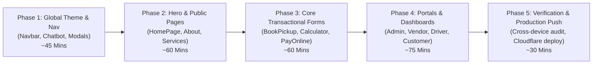

# Master Mobile Responsiveness Architecture, Complete Inventory & Remediation Plan
**Project:** Sai International Couriers & Cargo (`saiexpresscourier.com`)  
**Target Environment:** Cloudflare Pages (Frontend) + Render.com (Backend) + Android / Mobile Web  
**Standard Mobile Target Viewports:** 320px (Compact), 375px–430px (Standard iOS & Android), 768px (Tablet)  
**Status:** READY FOR PHASED EXECUTION  

---

## 1. Visual Defect Analysis from Real Mobile Screenshots

Based on the actual Android mobile device screenshots provided, four primary structural defects currently degrade the mobile user experience:

```mermaid
flowchart TD
    subgraph Defect1["Defect 1: Hero Button & Stats Overlap (Screenshot 1)"]
        A["'Explore Our Services' Floating CTA"] -->|Z-index & Margin Collision| B["Hero Stats Bar (195+ Countries / 50K+ Parcels)"]
        B --> C["Button covers stat numbers; touch targets blocked"]
    end

    subgraph Defect2["Defect 2: Theme Clashing on Subpages (Screenshot 4)"]
        D[".subpage-nav forced white background #FFFFFF"] -->|Stark split| E["BookPickupPage Dark Navy Hero #0b132b"]
        E --> F["White header cuts across midnight blue theme"]
    end

    subgraph Defect3["Defect 3: Floating Chatbot Collision (Screenshots 1, 3, 4)"]
        G["Fixed 24/7 AI Chatbot Avatar"] -->|No bottom clearance| H["Cards, Form Submit Buttons & Touch Controls"]
        H --> I["Obscures inputs on 360px-412px viewports"]
    end

    subgraph Defect4["Defect 4: Stepper Compression (Screenshot 4)"]
        J["3-Step Horizontal Wizard Stepper"] -->|Horizontal squeeze| K["Numbers (1, 2, 3) wrap awkwardly"]
        K --> L["Hard to tap and read on small screens"]
    end
```

---

## 2. Complete Inventory Across All 5 Portals

Every single page, sub-page, pop-up modal, interactive form, and data table across the entire codebase has been inventoried below:

### Category A: Public Customer Website (15 Pages)

| # | Route / Path | Page Component | Key Mobile Elements | Mobile Flaw Risk |
| :-: | :--- | :--- | :--- | :--- |
| 1 | `/` | `HomePage.jsx` | Hero aircraft banner, floating CTA, stats bar, marquee, services grid, testimonials | **High** (Hero button overlapping stats, large headline wrap) |
| 2 | `/about` | `AboutPage.jsx` | Story grid, stats counter, Managing Directors cards, contact grid | **Medium** (Director cards grid stacking on 360px) |
| 3 | `/services` | `ServicesPage.jsx` | 6 service offering cards, feature badges, CTA banner | **Low** (Card padding squeezing text) |
| 4 | `/air-freight` | `AirFreightPage.jsx` | Flight schedules, aircraft specs grid, volumetric rate info | **Medium** (2-column specs tables overflow) |
| 5 | `/sea-freight` | `SeaFreightPage.jsx` | Ocean cargo cards, container dimensions chart, port matrix | **Medium** (Dimension charts horizontal clipping) |
| 6 | `/ecommerce-logistics` | `EcommerceLogisticsPage.jsx` | B2B architecture diagram, integration cards, workflow steps | **High** (Large diagrams exceed mobile width) |
| 7 | `/express-courier` | `ExpressCourierPage.jsx` | 3-5 day transit maps, comparison table, rate tiers | **Medium** (Comparison table needs card mode) |
| 8 | `/food-shipping` | `FoodShippingPage.jsx` | Andhra pickles packaging guide, prohibited ingredients, shelf life | **Low** (Accordion list needs larger tap targets) |
| 9 | `/branches` | `BranchesPage.jsx` | Leaflet interactive map, 6 branch directory cards, direct call buttons | **High** (Map pinch-zoom hijacks vertical scroll) |
| 10 | `/customs-guide` | `CustomsGuidePage.jsx` | KYC documentation checklist, clearance timeline, country rules | **Low** (Text line-height and badge wrapping) |
| 11 | `/prohibited-items` | `ProhibitedItemsPage.jsx` | IATA dangerous goods search input, categorized prohibited pills | **Low** (Search input touch target sizing) |
| 12 | `/calculator` | `CalculatorPage.jsx` | Origin/Destination selectors, volumetric dimension inputs, quote card | **High** (Inline dimension fields clip on 360px) |
| 13 | `/tracking` | `TrackingPage.jsx` | AWB lookup bar, 5-stage milestone stepper, live GPS map | **High** (Stepper dots wrap, map touch hijacking) |
| 14 | `/advanced-tracking` | `AdvancedTrackingPage.jsx` | Multi-AWB bulk textarea, multi-consignment card results | **Medium** (Textarea width and card margins) |
| 15 | `/tracking-faqs` | `TrackingFaqsPage.jsx` | Expandable question accordions, support links | **Low** (Accordion icon alignment) |

---

### Category B: Transactional, Booking & Support Pages (4 Pages + 5 Forms)

| # | Route / Path | Page Component | Forms & Interactive Widgets | Mobile Flaw Risk |
| :-: | :--- | :--- | :--- | :--- |
| 16 | `/book-pickup` | `BookPickupPage.jsx` | **Form:** 3-Step Pickup Wizard (Sender, Receiver, Specs, CAPTCHA) | **High** (White navbar clash, stepper squishing, iOS zoom on inputs) |
| 17 | `/contact` | `ContactPage.jsx` | **Form:** Customer inquiry message form + branch cards | **Medium** (Inputs need 16px font to prevent iOS Safari auto-zoom) |
| 18 | `/help-center` | `HelpCenterPage.jsx` | **Form:** Support ticket creation form + ticket status search | **Medium** (Form button clearance from chatbot) |
| 19 | `/pay-online` | `PayOnlinePage.jsx` | **Form:** AWB payment form + Razorpay sandbox trigger + receipt modal | **High** (Receipt modal clipping, payment button sticky on mobile) |

---

### Category C: Authentication Gateways (5 Pages)

| # | Route / Path | Page Component | Forms & Auth Widgets | Mobile Flaw Risk |
| :-: | :--- | :--- | :--- | :--- |
| 20 | `/portal` | `PortalPage.jsx` | 5-Role gateway selector grid | **Low** (Ensure 1-column stack below 480px) |
| 21 | `/login` | `UserLoginPage.jsx` | **Form:** Tabbed Customer Login / Sign-up form + Google OAuth | **Medium** (Tab switcher touch size, OAuth button width) |
| 22 | `/admin/login` | `AdminLoginPage.jsx` | **Form:** Super Admin credentials form | **Low** (Clean centered card, ensure viewport centering) |
| 23 | `/vendor/login` | `VendorLogin.jsx` | **Form:** B2B Vendor store ID & password form | **Low** (Clean centered card) |
| 24 | `/delivery/login` | `DeliveryLogin.jsx` | **Form:** Delivery Executive mobile login + vehicle selector | **Low** (Mobile-first layout) |
| 25 | `*` | `NotFoundPage.jsx` | 404 Illustration, Return Home CTA | **Low** (Clean centered layout) |

---

### Category D: Registered Customer Dashboard (2 Views + 2 Modals)

| # | Route / Path | Page Component | Key Mobile Elements | Mobile Flaw Risk |
| :-: | :--- | :--- | :--- | :--- |
| 26 | `/dashboard` | `UserDashboard.jsx` | **Table:** Consignment history table &rarr; Card view on mobile | **High** (Desktop table overflows viewport; must become cards) |
| 27 | `/dashboard/rfq` | `UserRFQ.jsx` | **Form:** Bulk shipping RFQ form with route & volume fields | **Medium** (Multi-column inputs need single column stack) |

---

### Category E: Delivery Executive Mobile Application (3 Screens)

| # | Route / Path | Page Component | Key Mobile Elements | Mobile Flaw Risk |
| :-: | :--- | :--- | :--- | :--- |
| 28 | `/delivery` | `DeliveryDashboard.jsx` | Active task cards, filter tabs, quick call button, navigation | **Medium** (Ensure bottom navigation bar has safe-area inset) |
| 29 | `/delivery/task/:awb` | `DeliveryTaskDetail.jsx` | Status dropdown, customer caller, digital signature canvas, camera photo upload | **High** (Signature canvas touch coordinate accuracy, camera modal) |
| 30 | `/delivery/scan` | `DeliveryScanner.jsx` | Barcode/QR camera viewport, manual AWB keypad | **Medium** (Camera aspect ratio fitting on small screens) |

---

### Category F: B2B Vendor Portal (8 Views)

| # | Route / Path | Page Component | Key Mobile Elements | Mobile Flaw Risk |
| :-: | :--- | :--- | :--- | :--- |
| 31 | `/vendor` (Shell) | `VendorLayout.jsx` | Responsive sidebar drawer, store badge, top header | **High** (Sidebar drawer must slide in smoothly on mobile hamburger) |
| 32 | `/vendor` | `VendorDashboard.jsx` | 4 stat metric cards, sales volume graph, recent orders | **High** (Recharts graph overflow; needs responsive container) |
| 33 | `/vendor/products` | `VendorProducts.jsx` | **Modal/Form:** Product catalog grid, Add Product modal | **Medium** (Modal width on 360px, image file dropzone) |
| 34 | `/vendor/orders` | `VendorOrders.jsx` | **Table:** Wholesale order queue, packing slips | **High** (Table columns clip; transform to mobile order cards) |
| 35 | `/vendor/financials` | `VendorFinancials.jsx` | **Table/Modal:** Escrow balance card, ledger table, payout modal | **High** (Ledger table needs horizontal scroll or mobile card rows) |
| 36 | `/vendor/support` | `VendorSupport.jsx` | **Form:** Support ticket form, message thread | **Medium** (Message bubble widths on small screens) |
| 37 | `/vendor/rfq` | `VendorRFQ.jsx` | **Form:** Wholesale quote request form | **Medium** (Form inputs stack) |
| 38 | `/vendor/api` | `VendorAPI.jsx` | Webhook URL form, API key copy card, cURL snippet blocks | **High** (Code blocks must have horizontal scrolling with wrap control) |

---

### Category G: Super Admin Command Center (17 Management Panels)

| # | Route / Path | Page Component | Key Mobile Elements | Mobile Flaw Risk |
| :-: | :--- | :--- | :--- | :--- |
| 39 | `/admin/*` (Shell) | `AdminDashboard.jsx` | Collapsible sidebar, notification drawer, top bar | **High** (Sidebar must become off-canvas drawer on screens < 992px) |
| 40 | `/admin/dashboard` | `AdminHome.jsx` | Operations metrics, live chart, recent dispatch table | **High** (Charts and quick dispatch tables overflow) |
| 41 | `/admin/shipments` | `ShipmentsManager.jsx` | **Table:** Master shipment table, driver assign dropdown | **High** (Wide 8-column table must have touch card fallback) |
| 42 | `/admin/create-shipment` | `AdminCreateShipment.jsx`| **Form:** Comprehensive 15-field dispatch manifest form | **High** (Multi-column fields must stack smoothly on mobile) |
| 43 | `/admin/enterprise-awb` | `EnterpriseAWBManager.jsx`| **Form:** Batch AWB generator, barcode printer | **Medium** (Barcode preview grid wrapping) |
| 44 | `/admin/dispatch` | `DispatchManager.jsx` | Driver allocation list, route queue | **Medium** (Driver selection cards stacking) |
| 45 | `/admin/dispatch/map` | `AdminMap.jsx` | Real-time Leaflet fleet tracking map | **High** (Map needs mobile full-bleed and touch controls) |
| 46 | `/admin/fleet` | `AdminFleet.jsx` | **Table/Modal:** Van & bike asset table, Add Vehicle modal | **Medium** (Table horizontal scroll) |
| 47 | `/admin/bookings` | `BookingsManager.jsx` | **Table:** Customer pickup bookings table, convert action | **High** (Table actions button group wrapping) |
| 48 | `/admin/rate-manager` | `RateManager.jsx` | **Table/Modal:** Country tariffs table, edit price modal | **High** (Tariff table has 6 columns; needs scroll indicator) |
| 49 | `/admin/customers` | `CustomersManager.jsx` | **Table:** Customer database, phone, spend | **Medium** (Table horizontal scroll) |
| 50 | `/admin/ecommerce` | `EcommerceManager.jsx` | **Table:** Vendor stores review, catalog approvals | **Medium** (Store cards grid) |
| 51 | `/admin/pages` | `PageEditor.jsx` | **Form:** Live CMS text editor for Home, About, Services | **High** (Textarea editors must have proper mobile padding) |
| 52 | `/admin/branding` | `BrandingManager.jsx` | **Form:** Logo uploader, color picker, company name | **Medium** (Image preview bounds) |
| 53 | `/admin/media` | `MediaLibrary.jsx` | Cloud gallery grid, file dropzone | **Medium** (Grid items: 2 columns on mobile, 4 on desktop) |
| 54 | `/admin/messages` | `MessagesManager.jsx` | **Table:** Contact submissions inbox, reply modal | **Medium** (Message detail view sheet) |
| 55 | `/admin/contact-settings`| `ContactManager.jsx` | **Form:** Branch addresses & phone settings | **Medium** (Form stack) |
| 56 | `/admin/staff` | `StaffManager.jsx` | **Table:** Sub-admin staff and permissions | **Medium** (Permissions checklist wrapping) |
| 57 | `/admin/settings` | `AdminSettings.jsx` | **Form:** API keys, gateway switches | **Medium** (Input keys with toggle eye icons) |

---

### Category H: Global Modals & Shared Interactive Widgets (5 Components)

| # | Component | Key Mobile Elements | Mobile Flaw Risk |
| :-: | :--- | :--- | :--- |
| 58 | `Navbar.jsx` | Mobile hamburger drawer, language selector, CTA button | **High** (White background clashing on dark pages, drawer animation) |
| 59 | `ChatbotWidget.jsx` | Floating launcher bubble, fullscreen mobile chat window | **High** (Launcher obscures content on mobile; chat window needs fullscreen on <480px) |
| 60 | `AuthModal.jsx` | Customer login / register modal dialog | **High** (Must become bottom sheet or full-width modal on <480px) |
| 61 | `CookieBanner.jsx` | Cookie consent notification banner | **Medium** (Must stick to bottom without covering chatbot launcher) |
| 62 | `InvoiceGenerator.jsx`| Printable tax invoice & barcode modal | **High** (Modal must scale down to fit 360px viewport without clipping) |

---

## 3. Master Inventory Summary

| Total Evaluated Element | Count |
| :--- | :---: |
| **Total Distinct Pages & Route Views** | **53 Views** |
| **Total Interactive Forms & Wizards** | **22 Forms** |
| **Total Popup Modals & Dialogs** | **18 Modals** |
| **Total Data Tables** | **12 Tables** |
| **Total Shared Global Navigation & Overlays** | **5 Components** |

---

## 4. Mobile Responsiveness Standards & Core Rules

To guarantee 100% flawless mobile responsiveness across every iPhone and Android device, all changes must strictly adhere to these standards:

1. **No Horizontal Scroll on Mobile (Zero `overflow-x`):**  
   Every container must have `max-width: 100%; box-sizing: border-box; overflow-x: clip;`.
2. **Fluid Typography Formula (`clamp`):**  
   Replace hardcoded `font-size: 2.5rem` or `font-size: 3rem` with:  
   `font-size: clamp(1.4rem, 4.5vw, 2.5rem);` so headlines never overflow or break into awkward single words.
3. **No Component Collisions (Clearance Standards):**  
   - Floating buttons (e.g. `.hero-floating-center-cta`) must stack cleanly above `.hero-stats-bar` with explicit relative flow on mobile (`display: flex; margin: 1.5rem auto;`).
   - The AI Chatbot launcher bubble must maintain safe margin (`bottom: 1.5rem; right: 1rem`) and never cover form submission buttons.
4. **Theme Consistency for Subpage Navbars:**  
   The navigation bar (`.site-nav-wrapper`) must match the theme of the page beneath it. On dark subpages like `BookPickupPage`, `CalculatorPage`, and `TrackingPage`, the navbar must remain sleek dark or transparent blur, eliminating the jarring white bar shown in Screenshot 4.
5. **Table-to-Card Responsive Pattern:**  
   Tables with 4+ columns must either display an explicit touch horizontal scroll indicator (`overflow-x: auto; -webkit-overflow-scrolling: touch;`) or transform into stacked mobile cards below `768px`.
6. **Touch Targets & Form Usability:**  
   - All tap targets (buttons, links, inputs) must be at least `44px x 44px`.
   - All input fields must have a minimum `font-size: 16px` to prevent iOS Safari from zooming in automatically on focus.
   - Safe-area insets (`env(safe-area-inset-bottom)`) must be used for modern iPhones and punch-hole Android displays.

---

## 5. Phased Implementation Roadmap & Time Estimates

### Detailed Phase Breakdown

#### Phase 1: Global Navigation, Theme Uniformity & Floating Overlays
* **Target Files:** `Navbar.jsx`, `ChatbotWidget.jsx`, `AuthModal.jsx`, `CookieBanner.jsx`, `index.css`.
* **Key Tasks:**
  1. Fix the subpage navbar background clash (change white background to dark translucent blur on dark subpages).
  2. Redesign mobile hamburger navigation menu with smooth full-height slide-over drawer and 48px tap targets.
  3. Adjust Chatbot bubble positioning to avoid covering content, and make the chat window open in full-screen on screens `< 480px`.
  4. Ensure `AuthModal` scales as a native bottom sheet on mobile.
* **Estimated Time:** **45 Minutes**

#### Phase 2: Public Website Pages & Hero Stacking
* **Target Files:** `HomePage.jsx`, `AboutPage.jsx`, `ServicesPage.jsx`, `BranchesPage.jsx`, `index.css`.
* **Key Tasks:**
  1. **Fix Defect 1:** Fix `.hero-floating-center-cta` overlapping `.hero-stats-bar` by converting it to a natural vertical flex stack on screens `< 768px`.
  2. Make hero headline text responsive using `clamp()`.
  3. Ensure stats bar displays as a clean 2x2 grid with centered labels on mobile screens.
  4. Optimize Executive Leadership cards on `AboutPage.jsx` for clean single-column mobile reading.
  5. Fix Leaflet map on `BranchesPage.jsx` so users can scroll past the map without getting trapped by map pan gestures.
* **Estimated Time:** **60 Minutes**

#### Phase 3: Transactional Forms, Multi-Step Wizards & Payments
* **Target Files:** `BookPickupPage.jsx`, `CalculatorPage.jsx`, `TrackingPage.jsx`, `PayOnlinePage.jsx`, `HelpCenterPage.jsx`.
* **Key Tasks:**
  1. **Fix Defect 4:** Re-engineer the 3-Step Pickup Wizard Stepper (`1-2-3`) into a sleek mobile progress ring or compact numbered pill bar that never wraps or squishes.
  2. Set all form inputs to `font-size: 16px` to prevent iOS zoom-on-focus.
  3. Stack volumetric calculator inputs (Length, Width, Height) cleanly with touch increment controls.
  4. Ensure tracking 5-milestone radar displays vertically on mobile with connected timeline lines.
  5. Ensure payment verified tax receipt modal is scrollable and fits within 360px without edge clipping.
* **Estimated Time:** **60 Minutes**

#### Phase 4: Portals, Data Tables & Mobile Dashboards
* **Target Files:** `AdminDashboard.jsx`, `ShipmentsManager.jsx`, `VendorLayout.jsx`, `VendorOrders.jsx`, `DeliveryDashboard.jsx`, `UserDashboard.jsx`.
* **Key Tasks:**
  1. Transform data tables (Shipments, Orders, Bookings, Ledger) into responsive card lists below 768px.
  2. Implement off-canvas slide-out drawers for Super Admin and B2B Vendor sidebars on mobile.
  3. Optimize Delivery Agent signature canvas and camera preview for 1-handed mobile operation.
  4. Wrap Recharts analytics graphs inside responsive touch containers.
* **Estimated Time:** **75 Minutes**

#### Phase 5: Automated Mobile Device Audit & Cloudflare Deployment
* **Target Tasks:**
  1. Run automated headless viewport tests for 320px, 375px, 412px, and 768px.
  2. Verify zero horizontal overflow on all 53 routes.
  3. Build production bundle (`npm run build`).
  4. Commit and push to GitHub `main` for instant Cloudflare Pages production deployment.
* **Estimated Time:** **30 Minutes**

---

### Total Estimated Execution Time: **4.5 Hours** (Maximum changes for 100% complete mobile responsiveness across all 53 pages).
